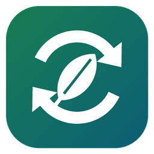
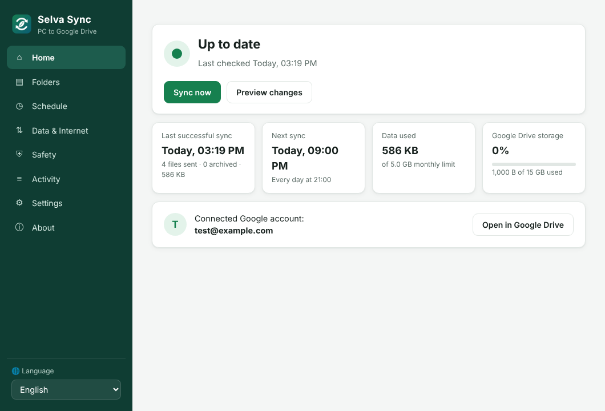
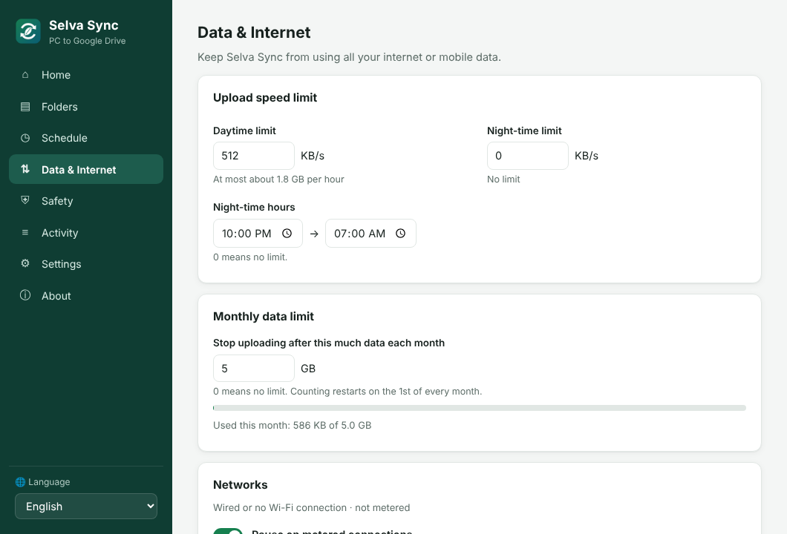
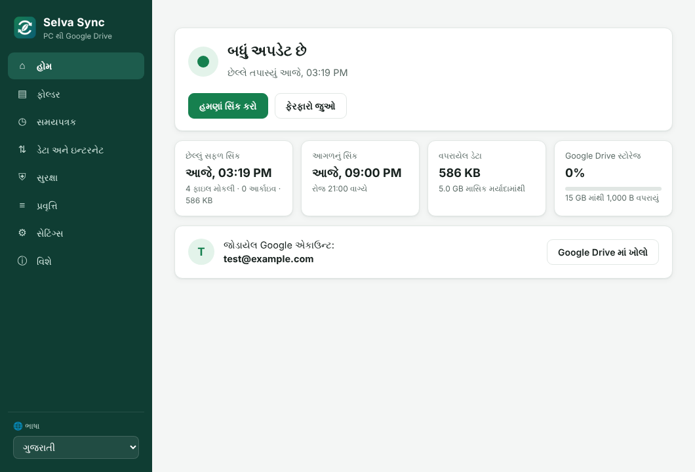
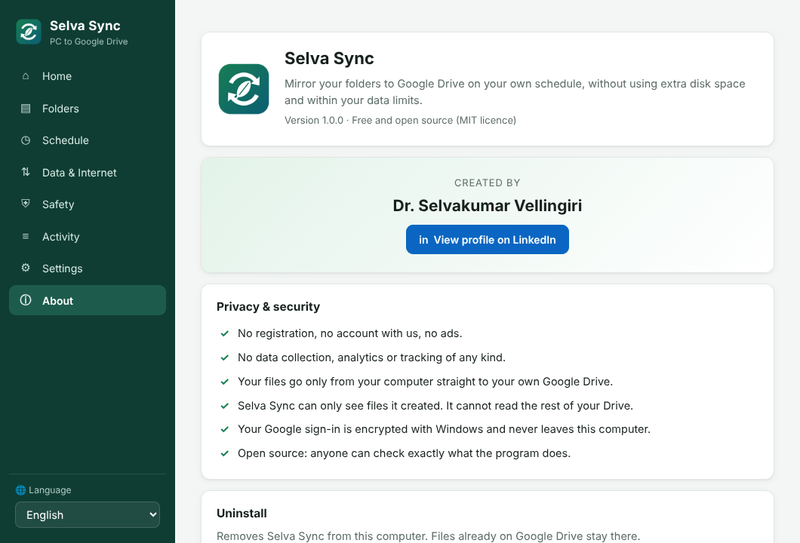

<p align="center"></p>

<h1 align="center">Selva Sync</h1>

<p align="center"><b>Mirror your PC folders to Google Drive on your own schedule, without using extra disk space and within your data limits.</b><br>
Free · Open source (MIT) · No registration · No tracking · About 7 MB</p>

<p align="center">Created by <a href="https://www.linkedin.com/in/selvakumar-vellingiri-phd-97744572/">Dr. Selvakumar Vellingiri</a></p>

---

## Why Selva Sync?

Google Drive for Desktop is convenient, but it keeps a local cache, syncs whenever it likes and can use up a limited internet connection. Selva Sync was built for people in offices, NGOs, schools and homes who need a **reliable, low-data backup of their important folders**, especially on slow or mobile internet.

| | Selva Sync |
|---|---|
| Extra disk space | **None.** Files are read where they are and sent straight to Drive. No cache folder. |
| What is uploaded | Only **new or changed** files (checked by size and last-modified time). |
| Duplicates | **Never.** Changed files replace their Drive copy, which keeps Google's version history. |
| Renamed / moved files | Moved or renamed **on Drive too, without uploading again** (contents are checked first). |
| Folders | Any folders or whole drives: C:, D:, USB and network drives. |
| Where on Drive | **One folder you choose**, in My Drive or a **shared drive**. Never anywhere else. |
| When | **Your schedule**: daily, weekly, every N hours, at startup or manual only. Missed runs catch up. |
| Internet use | Day and night **speed limits**, a **monthly data cap**, pause on **metered/mobile** connections, Wi-Fi allow/block lists. |
| Deleted files | Moved to a dated **Archive** folder on Drive and deleted permanently after the number of days you choose (default 90). Or keep them, or trash them: your choice. |
| Peace of mind | Red tray icon and a reminder if there has been no backup for a few days, a monthly report on Drive, size estimate before the first backup, and an *only when charging* option for laptops. |
| Offices | An **office setup file** gives every PC the same settings and can lock the ones staff shouldn't change. |
| Languages | English, हिन्दी, ગુજરાતી, मराठी, தமிழ், বাংলা, Español, Français, Português. **Anyone can add more.** |
| Privacy | Only your computer and your Google Drive are involved. No servers, no accounts, no analytics. |

## Screenshots

<p>




</p>

## Download and install (Windows 10 / 11)

1. Download **`SelvaSync.exe`** from the [Releases](../../releases) page.
2. Double-click it. Selva Sync installs itself for your Windows user. No administrator rights are needed, and there's nothing else to install.
3. If Windows shows *"Windows protected your PC"*, click **More info → Run anyway**. This appears for new programs that are not yet code-signed.
4. The Selva Sync window opens. Click **Connect Google Drive**, choose your folders, and pick a schedule.

Selva Sync then waits quietly in the notification area (bottom-right, near the clock) and syncs on schedule.

**Uninstall:** *Settings → Apps → Selva Sync → Uninstall*, or *About → Uninstall* inside the app. Files on Google Drive are never deleted by uninstalling.

## How your files appear on Google Drive

```
My Drive/
└── Selva Sync/
    ├── OFFICE-PC/                ← one folder per computer
    │   ├── C-Drive/Users/Selva/Documents/...
    │   ├── D-Drive/Accounts/2026/...
    │   └── Archive (Selva Sync)/
    │       └── 2026-10-24/...    ← files deleted on the PC that day
    └── FIELD-LAPTOP/
        └── ...
```

`Selva Sync` is the default. You can choose any other folder instead, also in a shared drive (for example `Shared drives / Office / PC Backups / OFFICE-PC / ...`); the layout inside it is the same. Each PC also gets a small monthly report file in its folder.

Several computers can safely share one Google account. Each one is identified by an anonymous machine tag, so even two PCs with the same name never mix their files.

## Privacy and security

- **No registration, no account with us, no ads, no analytics, no telemetry.** The program never contacts any server except Google's sign-in and Drive.
- **Minimum permission.** Selva Sync asks only for Google's `drive.file` permission: it can see **only the files and folders it created itself**, never the rest of your Drive.
- **Encrypted sign-in.** Your Google sign-in token is encrypted with Windows DPAPI and stored only on your computer. Only your Windows user account can decrypt it.
- **Local-only window.** The app window is served on `127.0.0.1` only, protected by a random session key, strict content-security rules and host checks.
- **No third-party code.** Selva Sync uses only the Go standard library, so the whole program can be audited.

See [docs/PRIVACY.md](docs/PRIVACY.md) for details.

## For publishers: the one-time Google setup

Every app that connects to Google Drive needs a free *OAuth Client ID* from Google Cloud. This takes about 15 minutes and is done **once by whoever publishes Selva Sync**, not by every user. Follow **[docs/GOOGLE-SETUP.md](docs/GOOGLE-SETUP.md)**.

When you have the `google-client.json` file, you can either:
- put it **next to `SelvaSync.exe`** and share both files together (no rebuild needed), or
- build it into the program (see [docs/BUILDING.md](docs/BUILDING.md)). The GitHub workflow in this repository does that automatically from repository secrets.

## Documentation

- [User guide](docs/USER-GUIDE.md): everyday use, explained simply
- [Google setup](docs/GOOGLE-SETUP.md): one-time Client ID setup for publishers
- [Privacy & security](docs/PRIVACY.md) · [Privacy policy page](docs/privacy.html)
- [Put the website online](docs/PUBLISH-WEBSITE.md): home page, privacy policy and terms for GitHub Pages
- [Add a language](docs/TRANSLATING.md)
- [Build from source](docs/BUILDING.md)

## Tested hard

Versions 1.1 and 1.2 went through four rounds of "try to break it" testing (data safety, security, Windows behaviour). Every problem found has an automated test, and the test suite also runs as a Windows program. See [CHANGELOG.md](CHANGELOG.md).

## Contributing

Bug reports, translations and improvements are welcome. Please open an issue or a pull request. To add a language, see [docs/TRANSLATING.md](docs/TRANSLATING.md). It only takes one text file.

## Why "Selva"?

**Short answer:** it's my name. **Long answer:** it's still my name, but with better excuses.

- 🌿 In **Tamil**, *selvam* means **wealth, treasure**. Your files are exactly that: twenty years of photos, the report you rewrote nine times, and that one Excel sheet nobody else understands.
- 🌳 In **Spanish, Portuguese and Italian**, *selva* means **forest, jungle**.

So Selva Sync takes your treasure and hides it safely in the forest of the cloud, where only you can find it. Think of it as a very polite squirrel that buries your files every night and, unlike real squirrels, never forgets where.

Yes, I named a backup app after myself. In my defence, "Treasure Forest Squirrel Sync" didn't fit on the icon.

## Credits

Created by Dr. Selvakumar Vellingiri. Co-developed with Claude (AI by Anthropic): I brought the problem, the chai and the name; Claude brought the code and the patience. ☕

## Licence

MIT © 2026 Dr. Selvakumar Vellingiri. Free to use, share and modify. See [LICENSE](LICENSE).

If Selva Sync helps you or your organisation, a mention or a message on [LinkedIn](https://www.linkedin.com/in/selvakumar-vellingiri-phd-97744572/) is always appreciated.
